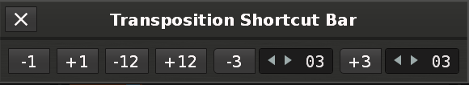

# Transposition Shortcut Bar

A Renoise tool that puts one-click note transposition buttons next to the pattern editor, so you don't have to dig through the right-click **Selection > Transpose Notes** menu.



## Installation

Drag `dist/com.ramiforms.TranspositionShortcutBar.xrnx` onto the Renoise window.

## Usage

Select notes in the pattern editor, then click a button:

| Button | Transposes the selection |
| --- | --- |
| `-1` / `+1` | down / up 1 semitone |
| `-12` / `+12` | down / up 12 semitones (one octave) |
| `-N` / `+N` | down / up by the value in the number box next to it (1–24) |

- The N values default to 3. They are saved with the tool, so they stay the same across songs and Renoise restarts.
- Only notes are changed. Note-offs and empty cells are skipped, and notes stop at C-0 and B-9.
- Each click is one undo step.

## Showing and hiding the bar

- The bar only appears on the **Edit** screen and hides on the other screens.
- **Tools > Transposition Shortcut Bar > Show/Hide Transposition Shortcut Bar** turns it on or off. **View > Transposition Shortcut Bar** does the same.
- Closing the bar's window also turns it off until you show it again.

Renoise doesn't let tools add controls inside the main window, so the bar is a small floating window. Drag it to wherever you like, such as next to the VOL/PAN/DLY/FX buttons.

## Keyboard shortcuts

You can assign these in **Preferences > Keys**. None have default keys.

- `Pattern Editor > Transposition Shortcut Bar > Transpose Notes Down N`
- `Pattern Editor > Transposition Shortcut Bar > Transpose Notes Up N`
- `Global > Tools > Toggle Transposition Shortcut Bar`

## Building

```bash
./build.sh
```

This zips `src/com.ramiforms.TranspositionShortcutBar.xrnx/` into `dist/`.

## Compatibility

Tested with Renoise 3.5.4 (tool API 6.2).

## License

MIT. See [LICENSE](LICENSE).
